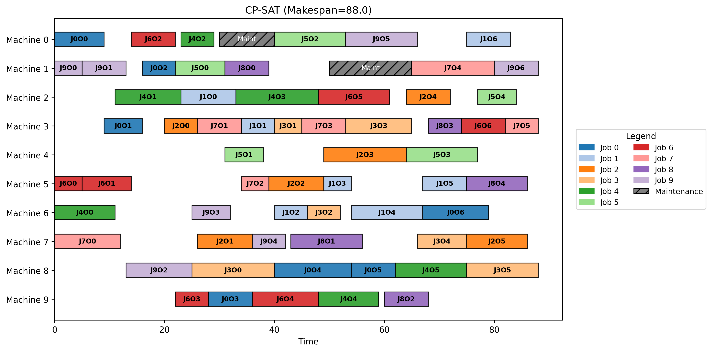
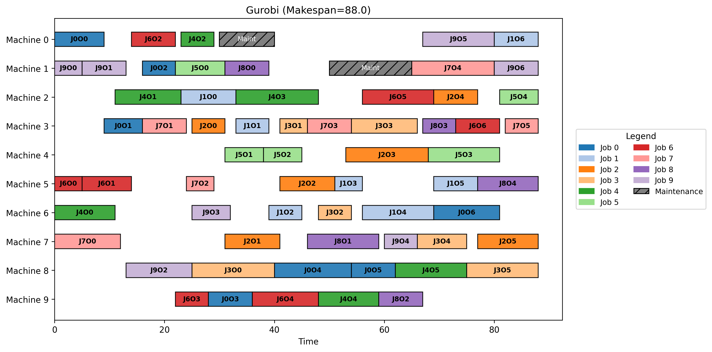
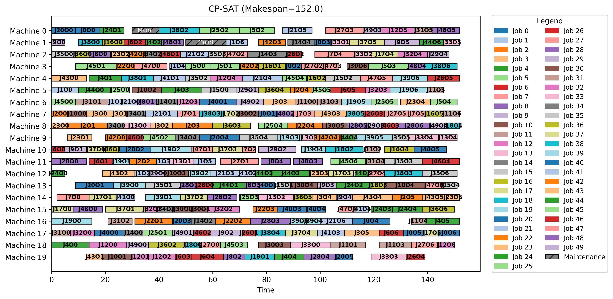

# FJSP Solver Comparison: CP-SAT vs Gurobi

[](https://www.python.org/)
[](https://github.com/google/or-tools)
[](https://www.gurobi.com/)

## 📌 项目简介

本项目针对真实制造业离散车间中的 **柔性作业车间调度问题（FJSP）**，构建了包含**机器维护时间窗**与**物料延迟释放**的复杂业务模型。

项目分别使用 **Google OR-Tools 的 CP-SAT（约束规划）** 和 **Gurobi（混合整数线性规划 MILP）** 进行建模求解，并在严格的控制变量（相同数据、相同约束）下，对两者的求解质量、响应速度以及规模承载力进行了横向对比。本项目旨在探索**复杂离散逻辑下不同数学建模范式的工程算力边界**。

## 🏭 核心业务场景

*   **柔性多机选择（FJSP）**：每道工序可以在 1~2 台候选机器中任选其一加工，且不同机器上的加工耗时不同。算法需自主决策最优机器分配。
*   **机器维护约束**：部分机器在特定时间段需停机维护，期间不可占用。
*   **物料释放时间**：部分订单有延迟到货时间（Release Time），首道工序必须在物料抵达后才能开工。
*   **优化目标**：最小化最大完工时间（Makespan）。

## 🚀 快速开始 (Quick Start)

### 1. 环境依赖
请确保已安装 Python (建议 3.10 及以上版本)。运行以下命令一键安装所需依赖：

```bash
pip install -r requirements.txt
```

### 2. 运行测试

在终端中执行主程序，即可重现上述实验数据并重新生成甘特图：

```bash
python main.py
```

## 📁 项目结构 (Project Structure)

```text
fjsp-cpsat-vs-gurobi/
├── images/                 # 存放 README 中引用的甘特图截图
├── output/                 # [本地生成] 程序运行产生的日志与图表（不参与 Git 追踪）
│
├── cpsat_solver.py         # CP-SAT 求解器（基于 OptionalIntervalVar 建模）
├── gurobi_solver.py        # Gurobi 求解器（基于大 M 法约束建模）
├── data_loader.py          # 数据生成器（模拟柔性、释放时间、维护时间约束）
├── visualizer.py           # 甘特图可视化模块
├── main.py                 # 项目主入口
│
├── requirements.txt        # 环境依赖清单（精确锁定版本，支持一键复现）
├── .gitignore              # Git 忽略规则（排除 output/ 和 __pycache__ 等）
├── LICENSE                 # MIT 开源许可证
└── README.md               # 本文件
```

## 📊 实验结果展示 (Benchmarks)

我们在 10x10（小规模）和 50x20（中大规模）两种测试用例下进行了对比实验。设定求解时间限制为 **30秒**。

### 场景 1：10 工件 x 10 机器（约 60 道工序）
| 求解器 | 求解状态 | Makespan | 耗时 | 表现分析 |
| :--- | :--- | :--- | :--- | :--- |
| **CP-SAT** | **OPTIMAL** | **88.0** | **0.15 s** | 秒级证明最优解 |
| **Gurobi** | OPTIMAL | 88.0 | 0.61 s | 证明最优解，但耗时约是 CP-SAT 的 4 倍 |

### 场景 2：50 工件 x 20 机器（约 300 道工序）
| 求解器 | 求解状态 | Makespan | 耗时 | 表现分析 |
| :--- | :--- | :--- | :--- | :--- |
| **CP-SAT** | **FEASIBLE** | **152.0** | 30.03 s | 在给定时间内稳定输出高质量可行解 |
| **Gurobi** | **FAILED** | - | - | **模型规模超限（变量爆炸）** |

> **💡 关于实验结果的补充说明：**
> 1. **关于 Gurobi 的规模限制**：由于 50x20 规模的 FJSP 变量与约束数量过多，超出了 Gurobi 官方提供的 **Size-Limited 免费受限版**（限制 2000 变量/约束）的许可范围，因此求解器直接报错拒绝求解。
> 2. **关于 CP-SAT 的结果波动**：在 50x20 规模下，CP-SAT 未能在 30 秒内证明全局最优，返回了 FEASIBLE（可行解）状态。由于我们未强制固定单线程和随机种子，CP-SAT 在多线程并行搜索时，每次运行找到的“当前最好可行解”在目标函数值上会出现小幅波动(例如某次测试结果为 152.0，重跑时可能会在附近浮动）。**这属于精确求解器在达到时间上限后提前截断（Anytime 特性）的正常现象**，不影响模型本身的正确性。

### 可视化调度甘特图 (Gantt Charts)

**1. 10x10 小规模测试（两者均达到最优）**

| CP-SAT (Makespan = 88.0) | Gurobi (Makespan = 88.0) |
| :---: | :---: |
|  |  |

**2. 50x20 大规模测试 (CP-SAT 30s 截断结果)**



---

## 💡 核心工程洞察

通过对实验数据的深度剖析，可总结出以下三点关键结论：

### 1. 现象观察：多重最优解 (Multiple Optimal Solutions)

在 10x10 规模下，CP-SAT 与 Gurobi 均在毫秒级证明了最优解 `Makespan = 88`。虽然两者的甘特图细节排布不同，但目标函数值完全一致。这是因为两者的底层搜索机制不同（CP-SAT 依靠约束传播，Gurobi 依靠分支定界），在巨大的解空间中找到了不同的“最优路径”登顶。
*   **工程意义**：在工业排产中，只要目标（如交期）达到最优，具体的排程方案往往不是唯一的。这验证了两个引擎在求解质量上是绝对对齐的。

### 2. 底层探究：建模范式的降维打击

为什么在相同目标下，两者的表现差异巨大？
*   **Gurobi (MILP)**：为了将“二选一”等业务逻辑线性化，必须引入大量的辅助 `0-1` 变量与大 `M` 约束。当规模增大时，模型迅速膨胀，导致求解缓慢甚至直接击穿 License 限制。
*   **CP-SAT (CP)**：采用 `OptionalIntervalVar` 和 `AddNoOverlap` 原生处理区间与互斥逻辑。它无需大 M 线性化，底层基于**约束传播(Constraint Propagation)** 剪枝，并结合**冲突驱动子句学习（CDCL）** 算法，在同等规模下内存占用极小，求解极快。

### 3. 规模边界与业务妥协

*   **小规模 (10x10)**：双方都能证明最优，但 CP-SAT 的效率高出数倍。
*   **中大规模 (50x20)**：变量或者约束过多导致超出Gurobi 的规模限制。而 CP-SAT 在 30 秒时间截断时（状态为 `FEASIBLE`），依然给出了高质量排程。
*   **工程价值**：在工业 APS 系统中，这种“在有限时间内给出当前最优解”的 **Anytime 特性**，远比等待几小时去证明绝对最优更具落地价值。

---

## ⚖️ License 与 第三方依赖声明

### License

本仓库的项目基于 [MIT LICENSE](./LICENSE) 开源。

### 第三方依赖声明

本仓库项目依赖的第三方库均遵循其各自的许可协议。用户需自行通过 `pip install -r requirements.txt` 安装，本项目不直接分发上述库的源码或二进制文件。具体包括：

- **开源库**：包括但不限于 OR-Tools (Apache License 2.0)、NumPy (BSD License)、Matplotlib (Matplotlib License) 等，均遵循其各自的开源许可证。

- **商业求解器**：本项目使用了 Gurobi 及其 Python 接口 gurobipy。Gurobi 属于商业闭源软件，本项目在测试时使用的是官方提供的 Size-Limited 免费受限版。使用者需自行前往 Gurobi 官网注册并获取对应的 License 才能运行相关代码。本项目不承担任何因使用 Gurobi 产生的版权或商业授权纠纷。
